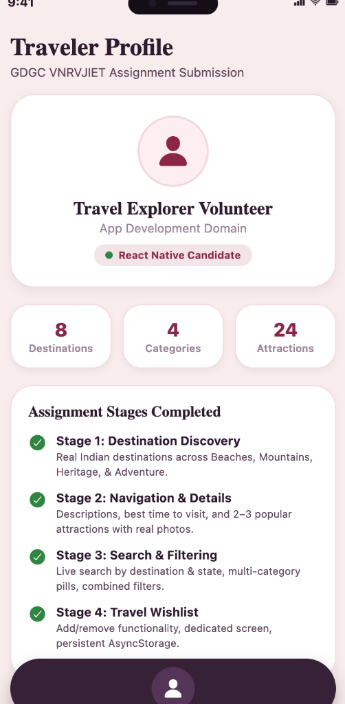
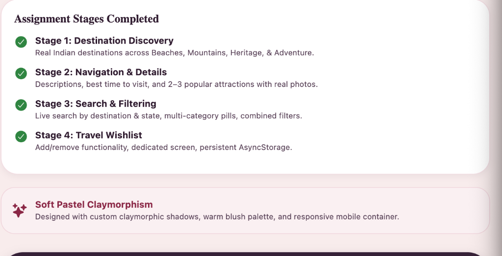
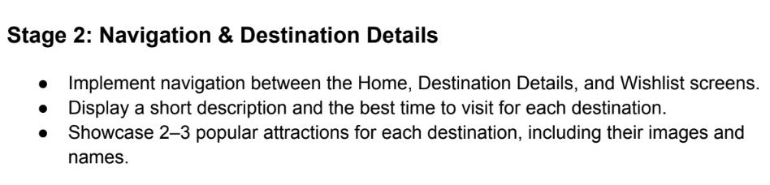
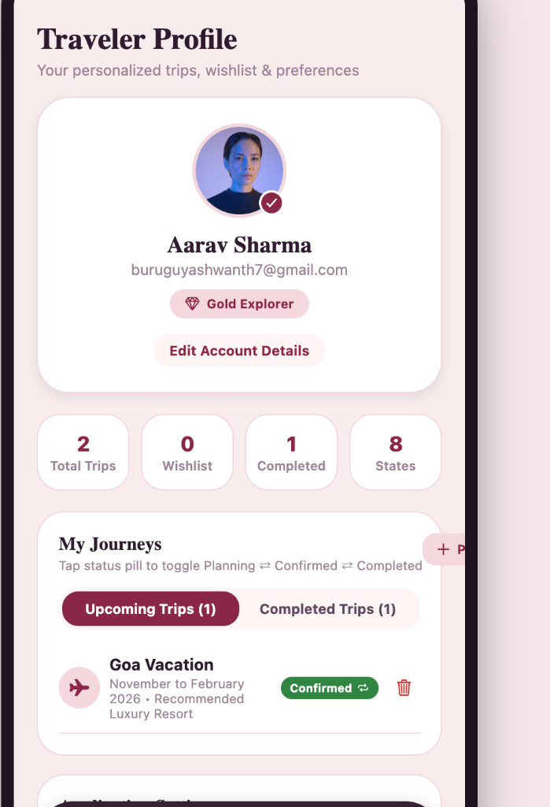
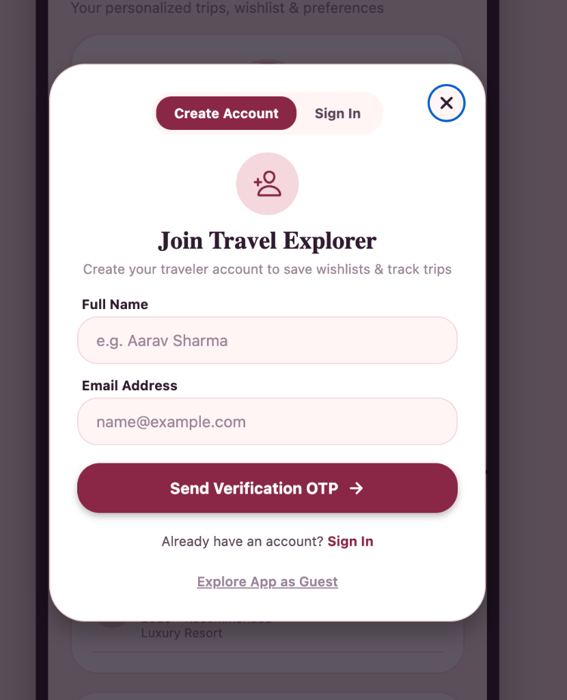

# 🧭 Travel Explorer App (India)

A modern, full-featured React Native (Expo) mobile travel discovery application for exploring incredible destinations across India. Built with a dual aesthetic architecture featuring **soft pastel claymorphism** and a **futuristic frosted glass HUD**, complete with live Open-Meteo weather integration, Google Maps routing, dynamic place-specific theming, a smart destination matcher, and interactive user journey management.

---

## 📸 App Screenshots & Visual Walkthrough

<div align="center">

| 🏠 Home Discovery | 🔍 Explore & Search | 📍 Destination Details |
| :---: | :---: | :---: |
|  |  |  |
| *Curated destinations, categories & featured spots* | *Real-time search by city/state & category pills* | *Weather, attractions, best time to visit & maps* |

<br/>

| ❤️ Travel Wishlist | 👤 Traveler Profile & Journeys | 🔐 Account Onboarding & OTP |
| :---: | :---: | :---: |
|  |  |  |
| *Saved destinations with persistent local storage* | *Interactive trip status (Planning ⇄ Confirmed ⇄ Done)* | *Email OTP verification & profile management* |

</div>

---

## 🌟 Live Demo & Deployment
* **GitHub Repository**: [https://github.com/buruguyashwanth7-cell/travel-explorer-app](https://github.com/buruguyashwanth7-cell/travel-explorer-app)
* **Web Preview**: Rendered inside an interactive mobile chassis with a real-time ticking clock, dynamic island, and responsive viewport adaptation.
* **Mobile Devices**: Runs natively on physical iOS and Android phones using the **Expo Go** app.

---

## 🎨 Visual Design & Aesthetic Highlights

- **Dual Aesthetic System**:
  - **Claymorphic Studio Mode**: Soft clay cards (`borderRadius: 24–36px`), multi-layer drop shadows, pastel blush (`#F8ECEC`) and royal burgundy (`#8A2846`) tones, and 3D-styled interactive experience tiles.
  - **Futuristic Glass HUD Mode**: Immersive full-bleed hero photography with dark cinematic vignette, frosted glass floating cards, glowing accent pills, and a floating bottom action dock.
- **Dynamic Place-Specific Theming Engine**: Selecting any destination (e.g. *Goa*, *Pondicherry*, *Manali*, *Varanasi*, *Jaipur*, *Tirupati*) dynamically updates the screen's color palette, glass tints, and experience badges to match that place's geography and culture!
- **1-Tap Interface Switcher**: An interactive switcher pill on every destination details page:
  $$\mathbf{[\ \text{🌌 Glass HUD}\ \ |\ \ \text{📋 Classic}\ ]}$$
- **Dynamic Dark Theme Mode**: Real-time theme toggle in Profile settings between warm blush claymorphism and sleek dark obsidian plum (`#180E1B`), persisted across sessions with `AsyncStorage`.
- **100% Authentic Photography**: Curated genuine travel photography from Unsplash for every destination and attraction (strictly zero AI-generated imagery).

---

## 📋 Core Requirements & Feature Breakdown

| Stage | Feature Name | Implementation Details | Status |
| :--- | :--- | :--- | :---: |
| **Stage 1** | **Destination Discovery** | 15+ curated Indian destinations across **Beaches**, **Mountains**, **Heritage**, **Adventure**, **Religious & Spiritual**, and **Wildlife**. Displays genuine photography, ratings, tags, and location. | ✅ Complete |
| **Stage 2** | **Navigation & Details** | Fluid React Navigation (Native Stack + Floating 4-Tab Dock). Displays hero banner, short & full descriptions, "Best Time to Visit", and 2–3 popular attractions with real photos. | ✅ Complete |
| **Stage 3** | **Search & Filtering** | Real-time live search bar (by destination name, location, or state), 7 category filter pills, combined search + category filtering, and zero-state handling. | ✅ Complete |
| **Stage 4** | **Travel Wishlist** | One-tap save/remove heart toggle across home cards, details screen, and dedicated Wishlist screen with instant remove action and `AsyncStorage` persistence. | ✅ Complete |
| **Extension 1** | **Smart Destination Matcher** | Interactive preference questionnaire matching destinations by **Budget** (Budget, Moderate, Luxury), **Duration** (Weekend, Week, Extended), **Companion Age Groups** (Young, Adults, Families, Seniors), and **Travel Pace**. Calculates match % score. | ✅ Complete |
| **Extension 2** | **Live Weather Integration** | Fetches and displays real-time live temperature in Celsius (`°C`), weather condition text, dynamic weather icon, humidity %, and wind speed (km/h) for every destination using the free public **Open-Meteo API**. | ✅ Complete |
| **Extension 3** | **Google Maps Integration** | "View on Google Maps" action button linking directly to Google Maps satellite navigation, driving directions, and local amenities for the selected destination. | ✅ Complete |
| **Extension 4** | **Interactive User Journeys** | Full user control over their travel plans in Profile. Tap any trip's interactive status pill to cycle between $\text{Planning} \rightarrow \text{Confirmed} \rightarrow \text{Completed}$. Users can also manually add custom trips or delete them. | ✅ Complete |
| **Extension 5** | **Profile Editor** | Dedicated "Edit Account Details" modal allowing travelers to customize their Full Name, Email, and Phone number with instant updates and local storage. | ✅ Complete |
| **Extension 6** | **Auth Gate & Live Clock** | Email OTP verification on launch (Create Account / Sign In with account validation) and real-time live ticking clock in the status bar. | ✅ Complete |

---

## 🧭 Curated Indian Destinations

The app includes authentic travel destinations across diverse categories:

1. **Beaches**:
   - **Goa** — *Sun, Sand & Portuguese Charm* (Baga Beach, Aguada Fort, Dudhsagar Falls)
   - **Pondicherry** — *French Riviera of the East* (Promenade Beach, Paradise Beach, Auroville)
   - **Andaman & Nicobar** — *Emerald Islands & Coral Reefs* (Radhanagar Beach, Elephant Beach, Cellular Jail)
   - **Gokarna** — *Untamed Shorelines & Sacred Waves* (Om Beach, Kudle Beach, Mahabaleshwar Temple)

2. **Mountains**:
   - **Manali** — *Snow Peaks & Alpine Thrills* (Solang Valley, Rohtang Pass, Hadimba Temple)
   - **Munnar** — *Misty Hills & Rolling Tea Gardens* (Eravikulam National Park, Mattupetty Dam, Tea Museum)
   - **Darjeeling** — *Queen of the Hills* (Tiger Hill Sunrise, Himalayan Railway, Tea Estate)

3. **Heritage & Palaces**:
   - **Jaipur** — *The Royal Pink City* (Hawa Mahal, Amber Fort, City Palace)
   - **Hampi** — *Ruins of the Vijayanagara Empire* (Virupaksha Temple, Stone Chariot, Lotus Mahal)

4. **Religious & Spiritual**:
   - **Varanasi** — *The Spiritual Heart of India* (Dashashwamedh Ghat Aarti, Kashi Vishwanath, Assi Ghat)
   - **Tirupati** — *Sacred Hills of Lord Balaji* (Sri Venkateswara Swamy, Kapila Theertham, Srivari Mettu)
   - **Amritsar** — *The Golden Oasis of Peace* (Harmandir Sahib Golden Temple, Wagah Border, Jallianwala Bagh)

5. **Adventure**:
   - **Rishikesh** — *River Rapids & Himalayan Serenity* (White Water Rafting, Lakshman Jhula, Bungee Jump)
   - **Leh-Ladakh** — *The Land of High Passes* (Pangong Tso Lake, Khardung La Pass, Nubra Dunes)

6. **Wildlife**:
   - **Jim Corbett National Park** — *Kingdom of the Royal Bengal Tiger* (Dhikala Safari, Corbett Falls, Ramganga River)

---

## 🏗️ Technical Architecture & Stack

- **Framework**: [React Native](https://reactnative.dev/) with [Expo](https://expo.dev/) (SDK 51)
- **Navigation**: `@react-navigation/native`, `@react-navigation/native-stack`, `@react-navigation/bottom-tabs`
- **Iconography**: `@expo/vector-icons` (Ionicons)
- **Persistent Storage**: `@react-native-async-storage/async-storage`
- **Live Weather API**: [Open-Meteo](https://open-meteo.com/) (Free, reliable, no API key required)
- **Maps**: External deep linking to Google Maps via React Native `Linking`
- **State Management**: React Context API (`ThemeContext`, `WishlistContext`, `TripsContext`, `AuthContext`)

### Project Structure
```
travel-explorer-app/
├── App.js                         # Root entry point with Providers & Responsive Shell
├── index.js                       # Expo entry point
├── app.json                       # Expo configuration
├── package.json                   # Dependencies & scripts
├── vercel.json                    # Automated Vercel deployment configuration
├── dist/                          # Production web bundle (pre-compiled)
├── screenshots/                   # Application screenshots for documentation
│   ├── 01_home_discovery.png
│   ├── 02_explore_search.png
│   ├── 03_destination_details.png
│   ├── 04_wishlist_screen.png
│   ├── 05_profile_journeys.png
│   └── 06_auth_onboarding.png
├── src/
│   ├── constants/
│   │   ├── colors.js              # Claymorphic design tokens (Light & Dark)
│   │   ├── destinationsData.js    # Curated Indian travel dataset with GPS coordinates
│   │   └── destinationThemes.js   # Dynamic place palettes & curated experiences
│   ├── context/
│   │   ├── ThemeContext.js        # Theme state & AsyncStorage persistence
│   │   ├── WishlistContext.js     # Saved destinations manager
│   │   ├── TripsContext.js        # User journeys & status cycle manager
│   │   └── AuthContext.js         # Email OTP onboarding & authentication state
│   ├── services/
│   │   └── weatherService.js      # Open-Meteo live climate fetcher
│   ├── navigation/
│   │   └── AppNavigator.js        # 4-Tab bottom dock + Stack navigation
│   ├── screens/
│   │   ├── HomeScreen.js          # Stage 1: Discovery, location header, featured carousel
│   │   ├── DetailsScreen.js       # Stage 2: Destination view container (Glass HUD & Classic)
│   │   ├── SearchScreen.js        # Stage 3: Live search & category filters
│   │   ├── WishlistScreen.js      # Stage 4: Wishlist management & empty state
│   │   └── ProfileScreen.js       # Traveler profile, interactive journeys & edit modal
│   └── components/
│       ├── GlassDestinationView.js # Futuristic Glass HUD view (Image 1 concept)
│       ├── SmartMatcherModal.js   # Interactive destination matcher modal
│       ├── LoginModal.js          # Email OTP authentication modal
│       ├── LocationPrompt.js      # Location permission modal
│       ├── DestinationCard.js     # Home & search destination card
│       ├── AttractionCard.js      # Attraction item card
│       ├── CategoryPill.js        # Filter pill with icons
│       └── MobileFrame.js         # Responsive mobile chassis for desktop web
└── assets/                        # Icons and static assets
```

---

## 🚀 Getting Started & Setup

### Prerequisites
- [Node.js](https://nodejs.org/) (v18 or higher recommended)
- [npm](https://www.npmjs.com/) or [yarn](https://yarnpkg.com/)

### 1. Installation
```bash
git clone https://github.com/buruguyashwanth7-cell/travel-explorer-app.git
cd travel-explorer-app
npm install
```

### 2. Running Locally

* **Web Browser** (renders inside the mobile preview chassis with live clock):
  ```bash
  npm run web
  ```
  Open `http://localhost:8081` in your browser.

* **Physical iOS / Android Device** (via Expo Go):
  ```bash
  npm start
  ```
  Scan the QR code printed in the terminal using the **Expo Go** app on your phone.

* **Android Emulator**:
  ```bash
  npm run android
  ```

* **iOS Simulator** (macOS only):
  ```bash
  npm run ios
  ```

### 3. Production Web Build & Export
```bash
npx expo export -p web
```
The compiled static assets are output to the `dist/` directory, ready to deploy to Vercel, Netlify, or GitHub Pages.

---

## 📄 License
This project is developed for educational and recruitment demonstration purposes. All destination imagery is attributed to their respective photographers on Unsplash.
